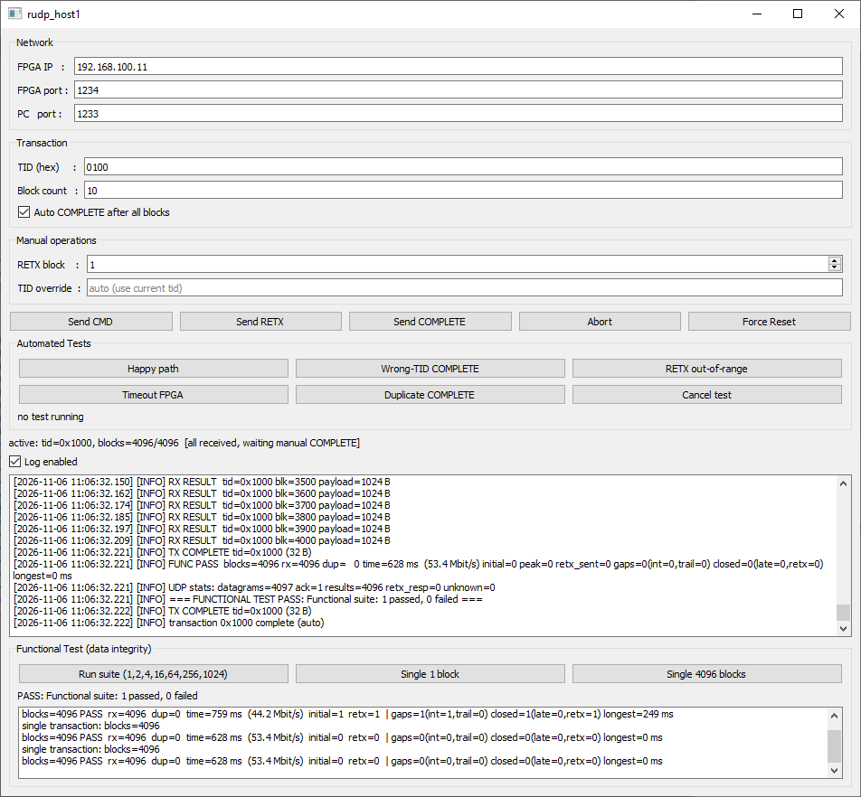
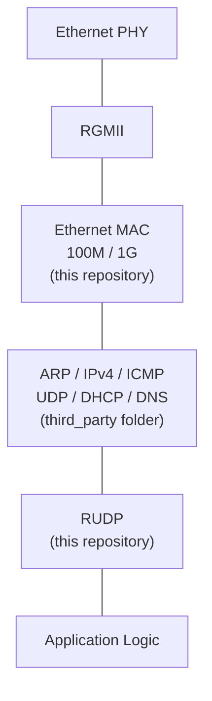
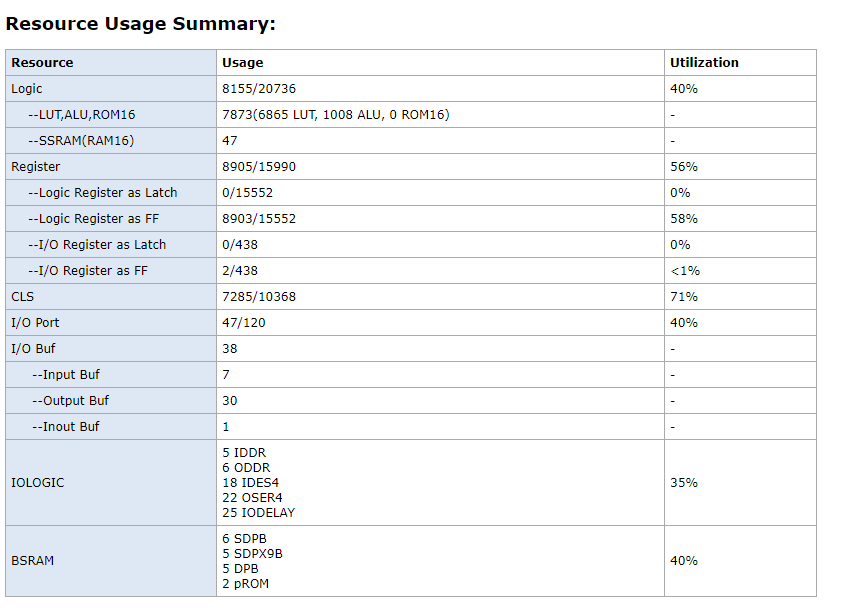
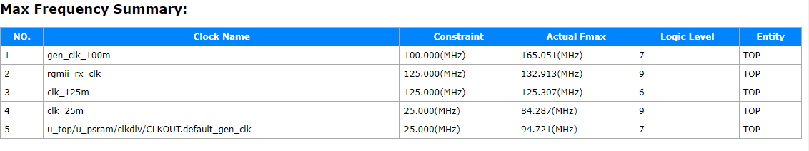
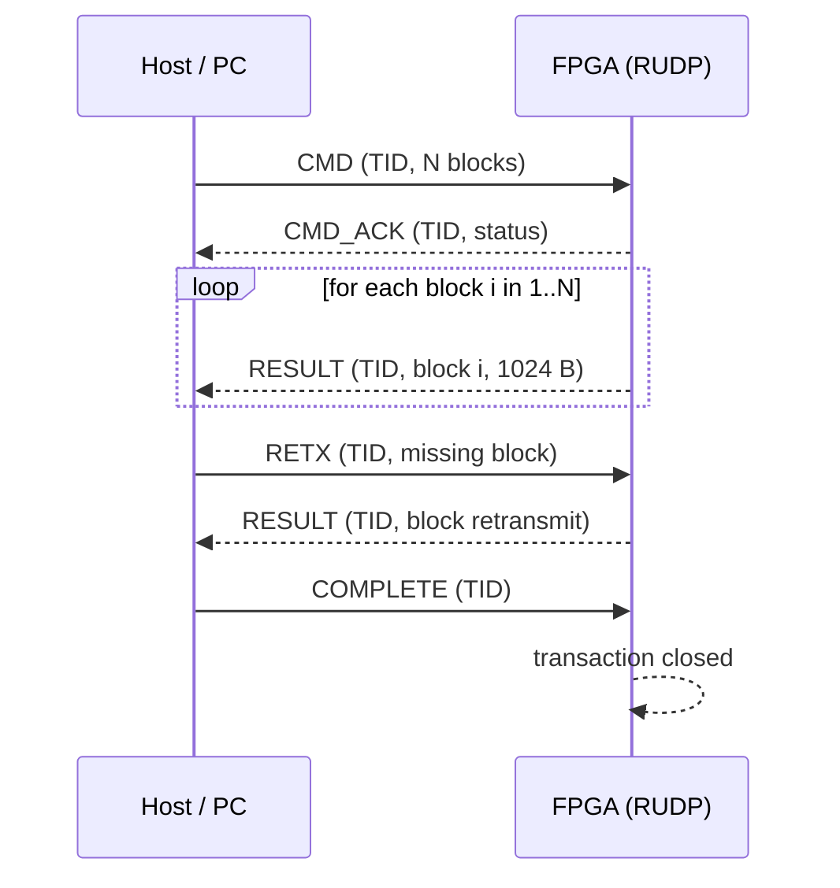
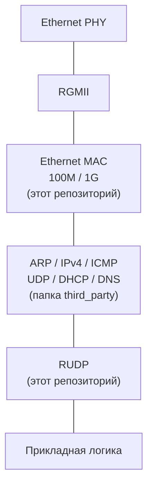
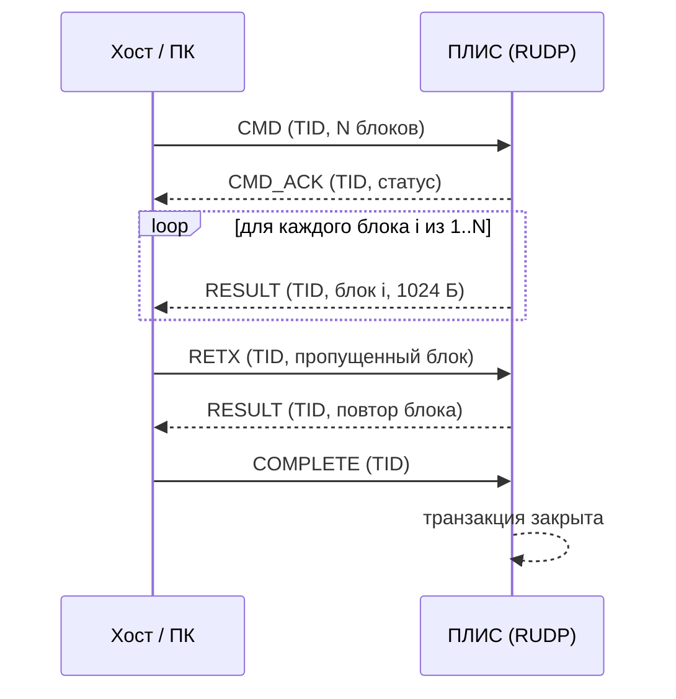

# FPGA Ethernet Stack for GOWIN — with RUDP

**English | [Русский](#русский)**


A SystemVerilog implementation of an **Ethernet MAC + Reliable UDP (RUDP)** for GOWIN FPGAs, together with a host-side test application and verification benches.

This repository focuses on two things:

- **Ethernet MAC / RGMII** — the link between FPGA logic and an external Ethernet PHY, supporting both **100 Mbps and 1 Gbps** operation.
- **RUDP** — a lightweight reliable transport on top of UDP, tailored for FPGA-to-host transfer of application data.

The rest of the networking stack (ARP, IPv4, ICMP, DHCP, DNS, UDP) is implemented in a **third-party open-source repository** and is **not part of this codebase**. See [External dependencies](#external-dependencies).

> **Development status:** hardware testing has been performed on GOWIN GW2AR-18. MAC and several RUDP scenarios have been verified in simulation and on real hardware. Further integration and long-duration testing are ongoing.

<div align="center">
  <p><b>RUDP Host Test Tool</b></p>
  
  <br/><br/>
  <p><b>Wireshark Capture</b></p>
  
  <br/>
  <p><i>Top: Host-side test application showing a successful 4096-block transaction (~53.4 Mbit/s). Bottom: Wireshark capture showing DHCP, ICMP, and RUDP UDP traffic.</i></p>
</div>

---

## Is this for you?

**Yes, if you:**
- Build an FPGA device that must send large, reliable payloads to a host over Ethernet.
- Need a flexible Ethernet interface supporting both 100 Mbps and 1 Gbps.
- Want TCP-level reliability without TCP-level RTL complexity.
- Target GOWIN GW2AR-18 (or a similar GOWIN part) and need a working, verified reference design.
- Need to easily integrate a reliable transport alongside an existing third-party network stack.

**No, if you:**
- Need a full TCP/IP stack out of the box (use the external stack, see below).
- Need multiple simultaneous network connections (this RUDP supports one active transaction at a time).
- Need Gigabit line-rate sustained throughput (this is a lightweight control/data protocol, not a bulk file transfer engine).

---

## Architecture

The full stack is assembled from **two sources**: this repository (MAC + RUDP) and the third-party repository (ARP / IPv4 / ICMP / DHCP / DNS / UDP).



---

## Performance & Resource Usage

Synthesized for **GOWIN GW2AR-LV18EQ144PC8/I7**.

### Measured Performance (Hardware)
The FPGA MAC/RGMII interface is capable of **1 Gbps**. The results below were measured using the host-side test tool over a physical **100 Mbps link**:
- **Transfer rate:** ~53.4 Mbit/s (sustained payload) for large 4096-block transfers.
- **Protocol Overhead:** Minimal; handles 1024-byte payloads per packet.
- **Data Integrity:** 4096 blocks (4 MB) verified with zero scoreboard errors.

### Resource Utilization

<div align="center">
  
</div>

| Resource | Usage | Utilization |
|---|---|---|
| **Logic (LUT/ALU)** | 7,873 | 40% |
| **Registers (FF)** | 8,905 | 56% |
| **CLS** | 7,285 | 71% |
| **BSRAM** | 18 blocks | 40% |
| **I/O Ports** | 47 | 40% |

### Timing (Fmax)

<div align="center">
  
</div>

| Clock Domain | Constraint | Actual Fmax | Logic Level |
|---|---|---|---|
| `gen_clk_100m` | 100.000 MHz | **165.051 MHz** | 7 |
| `rgmii_rx_clk` | 125.000 MHz | **132.913 MHz** | 9 |
| `clk_125m` | 125.000 MHz | **125.307 MHz** | 6 |

---

## Comparison

| Approach | FPGA Area | Reliability | RTL Complexity | Fits GW2AR-18? |
|---|---|---|---|---|
| Full TCP/IP Stack | High | ✅ | High | Tight (often requires external CPU) |
| Raw UDP | Low | ❌ (Packet loss unhandled) | Low | ✅ |
| **This RUDP** | **Medium (~40% Logic)** | **✅** | **Medium** | **✅ (Headroom available)** |

---

## Why RUDP and not TCP

A full TCP implementation on an FPGA is significant in area and complexity: connection state, congestion control, out-of-order reassembly, timers. For the target use case — a host sends a command, the FPGA produces a fixed number of fixed-size result blocks, the host acknowledges receipt — most of TCP is unnecessary overhead.

RUDP keeps the useful part (transaction ID, acknowledgements, retransmission, completion) and drops the rest. The result is a small, predictable RTL block with a straightforward state machine, easier to verify and easier to reason about on hardware.

---

## RUDP — Reliable UDP

RUDP is a lightweight application-level protocol implemented on top of UDP. It adds transaction identification, acknowledgements, block numbering, retransmission requests, and completion handling.

### Current protocol design

- **Command (`CMD`):** 1024 bytes.
- **Transaction ID (`TID`):** 16-bit identifier.
- **Command acknowledgement (`CMD_ACK`):** confirms acceptance of a valid command.
- **Result data (`RESULT`):** 1024-byte payload per block.
- **Retransmission request (`RETX`):** requests a particular result block again.
- **Completion (`COMPLETE`):** informs the FPGA that the host has completed receiving the results.
- **Block count:** 1 to 4096 result blocks per transaction.
- **Result storage:** designed for up to 4096 × 1024 bytes of result data.
- **Transaction handling:** one active command at a time.

### Transaction flow



### RUDP packet formats

The protocol defines five message types. All multi-byte fields are transmitted in little-endian order unless otherwise noted.

#### CMD — Command (PC → FPGA)

Total size: **1024 bytes**

| Byte offset | Field | Size (bytes) | Description |
|-------------|-------|--------------|-------------|
| 0 | `TID_LO` | 1 | Transaction ID, low byte |
| 1 | `TID_HI` | 1 | Transaction ID, high byte |
| 2 | `N_LO` | 1 | Number of result blocks, low byte |
| 3 | `N_HI[4:0]` | 1 | Number of result blocks, high bits (only lower 5 bits used) |
| 4–1023 | Reserved / padding | 1020 | Reserved for future use |

#### CMD_ACK — Command acknowledgement (FPGA → PC)

Total size: **4 bytes**

| Byte offset | Field | Size (bytes) | Description |
|-------------|-------|--------------|-------------|
| 0 | `TID_LO` | 1 | Transaction ID, low byte |
| 1 | `TID_HI` | 1 | Transaction ID, high byte |
| 2 | Status | 1 | 0 = command accepted; other values reserved |
| 3 | Reserved | 1 | Reserved for future use |

#### RESULT — Result block (FPGA → PC)

Total size: **1028 bytes** (4-byte header + 1024-byte payload)

| Byte offset | Field | Size (bytes) | Description |
|-------------|-------|--------------|-------------|
| 0 | `TID_LO` | 1 | Transaction ID, low byte |
| 1 | `TID_HI` | 1 | Transaction ID, high byte |
| 2 | `BLOCK_LO` | 1 | Result block number, low byte |
| 3 | `BLOCK_HI[4:0]` | 1 | Result block number, high bits (only lower 5 bits used) |
| 4–1027 | Data | 1024 | Result block payload |

#### RETX — Retransmission request (PC → FPGA)

Total size: **4 bytes**

| Byte offset | Field | Size (bytes) | Description |
|-------------|-------|--------------|-------------|
| 0 | `TID_LO` | 1 | Transaction ID, low byte |
| 1 | `TID_HI` | 1 | Transaction ID, high byte |
| 2 | `BLOCK_LO` | 1 | Requested result block number, low byte |
| 3 | `BLOCK_HI[4:0]` | 1 | Requested result block number, high bits (only lower 5 bits used) |

#### COMPLETE — Completion notification (PC → FPGA)

Total size: **4 bytes**

| Byte offset | Field | Size (bytes) | Description |
|-------------|-------|--------------|-------------|
| 0 | `TID_LO` | 1 | Transaction ID, low byte |
| 1 | `TID_HI` | 1 | Transaction ID, high byte |
| 2 | Reserved | 1 | Reserved for future use |
| 3 | Reserved | 1 | Reserved for future use |

---

## External dependencies

> **⚠️ Important:** ARP, IPv4, ICMP, DHCP, DNS and UDP are **not** part of this repository.  
> They are implemented in a third-party open-source project and are located in the **`third_party`** folder of this repository for convenience.  
> That external code is maintained by its own authors. This repository provides only **MAC**, **RUDP**, and the **test application / testbenches**.

---

## Project structure

```text
.
├── EU1Gv16.01/rudp_stage4  # Main FPGA project, RTL, and Gowin IDE files
├── rudp_host1              # Host-side test application (GUI)
├── third_party             # External network stack (ARP, IPv4, ICMP, DHCP, DNS, UDP)
├── docs                    # Images and screenshots for README
├── .gitattributes
├── .gitignore
├── LICENSE                 # MIT License
└── README.md
```

### RUDP RTL modules

| Module | Purpose |
|---|---|
| `rudp_types.sv` | Shared protocol definitions and state types |
| `rudp_rx_parser.sv` | Incoming RUDP packet parsing |
| `cmd_fsm.sv` | Command processing state machine |
| `exec_engine.sv` | Application command execution interface |
| `result_ram.sv` | Result block storage |
| `rudp_tx.sv` | Outgoing RUDP packet generation |
| `rudp_core.sv` | Main RUDP control and transaction state machine |

---

## Quick start

```bash
# 1. Clone
git clone https://github.com/Deynonih-AI/RUDP.git
cd RUDP

# 2. Run the RUDP simulation (example)
make sim          # or: ./scripts/run_questa.sh

# 3. (optional) Build the host-side test application
make -C sw        # or see sw/README for the exact command
```

---

## License

This project is licensed under the **MIT License**. See the [LICENSE](LICENSE) file for details.

---


# Русский

**[English](#fpga-ethernet-stack-for-gowin--with-rudp) | Русский**


Реализация **Ethernet MAC + Reliable UDP (RUDP)** на SystemVerilog для ПЛИС GOWIN, а также тестовое приложение для хоста и тестовые стенды.

В этом репозитории находятся:

- **Ethernet MAC / RGMII** — связь логики ПЛИС с внешним Ethernet PHY с поддержкой скоростей **100 Мбит/с и 1 Гбит/с**.
- **RUDP** — лёгкий надёжный транспорт поверх UDP, ориентированный на передачу прикладных данных между ПЛИС и хостом.

Остальная часть сетевого стека (ARP, IPv4, ICMP, DHCP, DNS, UDP) реализована в **стороннем открытом репозитории** и **в этот репозиторий не входит**. Подробнее — в разделе [Внешние зависимости](#внешние-зависимости).

<div align="center">
  <p><b>Тестовое приложение RUDP</b></p>
  
  <br/><br/>
  <p><b>Захват в Wireshark</b></p>
  
  <br/>
  <p><i>Сверху: Тестовое приложение (успешная передача 4096 блоков на ~53.4 Мбит/с). Снизу: Wireshark (трафик DHCP, ICMP и UDP-пакеты RUDP).</i></p>
</div>

---

## Вам нужен этот проект?

**Да, если вы:**
- Разрабатываете FPGA-устройство, которому нужно надёжно передавать большие объёмы данных на хост по Ethernet.
- Нужен гибкий интерфейс Ethernet с поддержкой 100 Мбит/с и 1 Гбит/с.
- Хотите получить надёжность уровня TCP, но без сложности реализации TCP на RTL.
- Используете GOWIN GW2AR-18 (или похожую ПЛИС) и ищете рабочий, проверенный референс.
- Хотите легко интегрировать надёжный транспорт рядом со сторонним сетевым стеком.

**Нет, если вам:**
- Нужен полный TCP/IP стек «из коробки» (используйте внешний репозиторий).
- Нужны множественные одновременные соединения (данный RUDP поддерживает одну активную транзакцию за раз).
- Нужна пропускная способность на уровне гигабитной линии.

---

## Архитектура

Полный стек собирается из **двух источников**: этот репозиторий (MAC + RUDP) и сторонний репозиторий (ARP / IPv4 / ICMP / DHCP / DNS / UDP).



---

## Производительность и ресурсы

Синтезировано для **GOWIN GW2AR-LV18EQ144PC8/I7**.

### Измеренная производительность (железо)

Интерфейс MAC/RGMII ПЛИС поддерживает скорость **1 Гбит/с**. Приведённые ниже результаты получены с помощью тестового приложения на физическом канале **100 Мбит/с**:
- **Скорость передачи:** ~53.4 Мбит/с (устойчивая полезная нагрузка) на больших передачах (4096 блоков).
- **Целостность данных:** 4096 блоков (4 МБ) проверены без ошибок.

### Использование ресурсов

<div align="center">
  
</div>

| Ресурс | Использование | Утилизация |
|---|---|---|
| **Логика (LUT/ALU)** | 7 873 | 40% |
| **Регистры (FF)** | 8 905 | 56% |
| **CLS** | 7 285 | 71% |
| **BSRAM** | 18 блоков | 40% |
| **I/O порты** | 47 | 40% |

### Тайминги (Fmax)

<div align="center">
  
</div>

| Домен | Ограничение | Фактический Fmax | Уровень логики |
|---|---|---|---|
| `gen_clk_100m` | 100.000 МГц | **165.051 МГц** | 7 |
| `rgmii_rx_clk` | 125.000 МГц | **132.913 МГц** | 9 |
| `clk_125m` | 125.000 МГц | **125.307 МГц** | 6 |

---

## Сравнение

| Подход | Площадь на ПЛИС | Надёжность | Сложность RTL | Подходит для GW2AR-18? |
|---|---|---|---|---|
| Полный TCP/IP | Высокая | ✅ | Высокая | Впритык (часто нужен внешний CPU) |
| Чистый UDP | Низкая | ❌ (потери не обрабатываются) | Низкая | ✅ |
| **Данный RUDP** | **Средняя (~40% логики)** | **✅** | **Средняя** | **✅ (есть запас)** |

---

## Почему RUDP, а не TCP

Полноценный TCP на ПЛИС требует существенных ресурсов и сложен в реализации: состояние соединения, управление перегрузкой, переупорядочивание, таймеры. Для типового сценария — хост отправляет команду, ПЛИС формирует фиксированное число блоков фиксированного размера, хост подтверждает получение — большая часть TCP избыточна.

RUDP сохраняет полезное (идентификатор транзакции, подтверждения, повторную передачу, завершение) и отбрасывает остальное. Результат — компактный RTL-блок с предсказуемым конечным автоматом, который проще верифицировать и проще отлаживать на железе.

---

## RUDP — надёжная передача поверх UDP

RUDP — собственный прикладной протокол поверх UDP. Он добавляет идентификатор транзакции, подтверждение команды, нумерацию блоков, запрос повторной передачи и сообщение о завершении приёма.

### Текущие параметры протокола

- **Команда (`CMD`):** 1024 байта.
- **Идентификатор транзакции (`TID`):** 16 бит.
- **Результат (`RESULT`):** 1024 байта полезных данных на блок.
- **Количество блоков:** от 1 до 4096 на одну транзакцию.
- **Хранение результатов:** предусмотрено до 4096 × 1024 байт.
- **Обработка команд:** одновременно выполняется одна активная транзакция.

### Ход транзакции



*(Таблицы форматов пакетов CMD, CMD_ACK, RESULT, RETX, COMPLETE остаются без изменений, как в английской версии выше)*

---

## Внешние зависимости

> **⚠️ Важно:** ARP, IPv4, ICMP, DHCP, DNS и UDP **не входят** в этот репозиторий.  
> Они реализованы в стороннем открытом проекте и для удобства размещены в папке **`third_party`**.  
> Этот сторонний код поддерживается его авторами. В данном репозитории есть только **MAC**, **RUDP** и **тестовое приложение / тестбенчи**.

---

## Структура проекта

```text
.
├── EU1Gv16.01/rudp_stage4  # Основной проект ПЛИС, RTL и файлы Gowin IDE
├── rudp_host1              # Тестовое приложение для хоста (GUI)
├── third_party             # Внешний сетевой стек (ARP, IPv4, ICMP, DHCP, DNS, UDP)
├── docs                    # Изображения и скриншоты для README
├── .gitattributes
├── .gitignore
├── LICENSE                 # Лицензия MIT
└── README.md
```

---

## Лицензия

Проект распространяется под лицензией **MIT**. Подробности в файле [LICENSE](LICENSE).
```