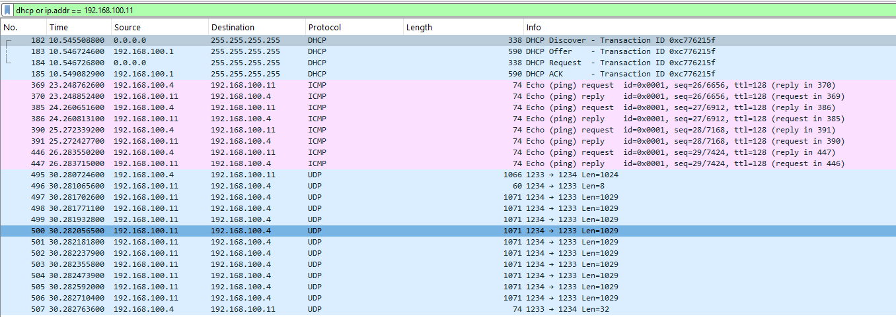

# FPGA Ethernet Stack for GOWIN — with RUDP

**English | [Русский](#русский)**


A SystemVerilog implementation of an **Ethernet MAC + Reliable UDP (RUDP)** for GOWIN FPGAs, together with a host-side test application and verification benches.

This repository focuses on two things:

- **Ethernet MAC / RGMII** — the link between FPGA logic and an external Ethernet PHY.
- **RUDP** — a lightweight reliable transport on top of UDP, tailored for FPGA-to-host transfer of application data.

The rest of the networking stack (ARP, IPv4, ICMP, DHCP, DNS, UDP) is implemented in a **third-party open-source repository** and is **not part of this codebase**. See [External dependencies](#external-dependencies).

> **Development status:** hardware testing has been performed on GOWIN GW2AR-18. MAC and several RUDP scenarios have been verified in simulation and on real hardware. Further integration and long-duration testing are ongoing.

<div align="center">
  
  
  <p><i>Left: Host-side test application showing a successful 4096-block transaction (~53.4 Mbit/s). Right: Wireshark capture showing DHCP, ICMP, and RUDP UDP traffic.</i></p>
</div>

---

## Is this for you?

**Yes, if you:**
- Build an FPGA device that must send large, reliable payloads to a host over Ethernet.
- Want TCP-level reliability without TCP-level RTL complexity.
- Target GOWIN GW2AR-18 (or a similar GOWIN part) and need a working, verified reference design.
- Need to easily integrate a reliable transport alongside an existing third-party network stack.

**No, if you:**
- Need a full TCP/IP stack out of the box (use the external stack, see below).
- Need multiple simultaneous network connections (this RUDP supports one active transaction at a time).
- Need Gigabit line-rate sustained throughput (this is a lightweight control/data protocol, not a bulk file transfer engine).

---

## Architecture

The full stack is assembled from **two sources**: this repository (MAC + RUDP) and the third-party repository (ARP / IPv4 / ICMP / DHCP / DNS / UDP).

```text
                         Ethernet PHY
                              |
                             RGMII
                              |
                  +-----------+-----------+
                  |   Ethernet MAC        |   <-- this repository
                  +-----------+-----------+
                              |
                  +-----------+-----------+
                  |   ARP / IPv4 / ICMP   |   <-- third_party folder
                  |   UDP / DHCP / DNS     |
                  +-----------+-----------+
                              |
                  +-----------+-----------+
                  |        RUDP           |   <-- this repository
                  +-----------+-----------+
                              |
                      Application logic